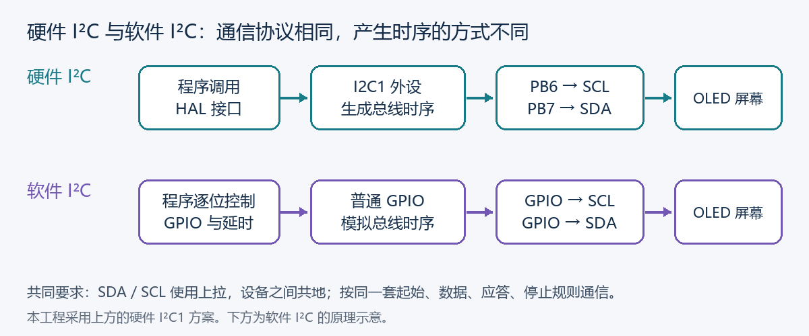

# 第一次电控作业

## 任务一 I2C 是怎么通信的

I²C是一种同步、串行、双向通信总线，广泛应用于微控制器与各类外围设备之间的数据传输。该总线主要由串行数据线（SDA）和串行时钟线（SCL）组成，其中，SDA 用于传输数据，SCL 用于提供通信所需的时钟信号，各设备之间还需具有共同的参考地（GND）。由于数据传输采用双向共享的数据线，同一时刻通常仅允许一个设备发送数据，因此 I²C 通信具有半双工特征。

I²C 总线采用主从通信机制，主机负责发起通信、产生时钟信号并控制数据传输过程，从机则根据主机发送的地址及控制信息作出相应响应。此外，I²C 支持多主机、多从机的总线结构，并通过总线仲裁机制协调多个主机之间的访问冲突。

I²C 通信过程主要包括以下五个阶段：

### （1）起始信号的产生

当总线处于空闲状态时，SDA 和 SCL 均保持高电平。主机在 SCL 为高电平期间，将 SDA 由高电平拉低，产生起始信号，标志着一次通信过程的开始。

### （2）设备地址的传输

7 位的寻址模式最为常见，主机首先发送 7 位从机地址，随后发送 1 位读写控制位（R/W）。当 R/W 为 0 时，表示主机向从机写入数据；当 R/W 为 1 时，表示主机从从机读取数据。总线上的从机对接收到的地址进行匹配，地址匹配的从机通过应答信号确认通信请求。

### （3）数据传输与应答机制

I²C 采用以字节为单位的数据传输方式，每个字节由 8 位数据组成，并按照最高有效位（MSB）优先的顺序依次发送。在完成 8 位数据传输后，第 9 个时钟周期用于应答信号的传输。此时，发送方释放 SDA，接收方通过控制 SDA 电平表示接收状态：将 SDA 拉低表示确认应答（ACK），保持 SDA 为高电平则表示非确认应答（NACK）。在一般通信过程中，时钟信号由当前主机提供，包括应答阶段所需的时钟脉冲。

### （4）数据读写过程

I²C 总线的数据传输方向由读写控制位决定。在写操作过程中，主机作为发送方，将数据逐字节传输至从机，从机在接收到数据后返回应答信号。在读操作过程中，从机作为发送方，主机负责接收数据。当主机需要继续接收后续字节时，通过发送 ACK 表示继续读取；当主机完成最后一个字节的接收后，则发送 NACK，表示不再接收后续数据。

### （5）停止信号与重复起始信号

数据传输完成后，主机在 SCL 保持高电平期间，将 SDA 由低电平释放至高电平，产生停止信号（STOP），标志着当前通信过程结束。在需要连续执行多次操作或切换读写方向时，主机也可以发送重复起始信号（Repeated START），在不释放总线的情况下启动新的传输阶段。

I²C 通信对数据与时钟信号之间的时序关系具有明确要求。在正常数据传输阶段，SDA 上的数据应在 SCL 为低电平期间发生变化，并在 SCL 为高电平期间保持稳定，以保证接收设备能够正确识别数据。起始信号与停止信号则是这一时序规则的特殊情况，分别通过 SCL 高电平期间 SDA 的下降沿和上升沿进行识别。

## 任务三 硬件 I2C 与软件 I2C 的区别

软件 I²C 通过普通通用输入输出引脚（GPIO）模拟 I²C 总线的通信时序，实现数据的发送与接收。在通信过程中，微控制器通过软件程序控制 SCL 和 SDA 的电平变化，并利用延时函数或定时机制调整各信号的持续时间，以满足 I²C 协议规定的时序要求。

软件 I²C 与硬件 I²C 均遵循相同的通信协议，其主要区别在于时序信号的产生与控制方式。软件 I²C 由程序控制 GPIO 实现通信时序，而硬件 I²C 则通过微控制器内部的专用 I²C 外设自动完成主要的时序控制与数据传输。

表 1  硬件 I2C 与软件 I2C 的比较

| 对比内容 | 硬件 I2C | 软件 I2C |
| --- | --- | --- |
| 时序产生 | 专用 I2C 外设产生 | 程序控制 GPIO 和延时产生 |
| 引脚选择 | 使用芯片支持的 I2C 引脚及映射方案 | 可选择合适的普通 GPIO |
| CPU 占用 | 取决于驱动方式，可使用中断或 DMA | 常见的延时实现需要 CPU 持续参与 |
| 时序与速度 | 通过外设参数配置，通常更稳定 | 受延时实现、CPU 速度和中断影响 |
| 使用特点 | 适合已有外设和驱动支持的项目 | 引脚安排灵活，需要自行处理时序和应答 |

图 1  两种 I2C 实现方式示意
